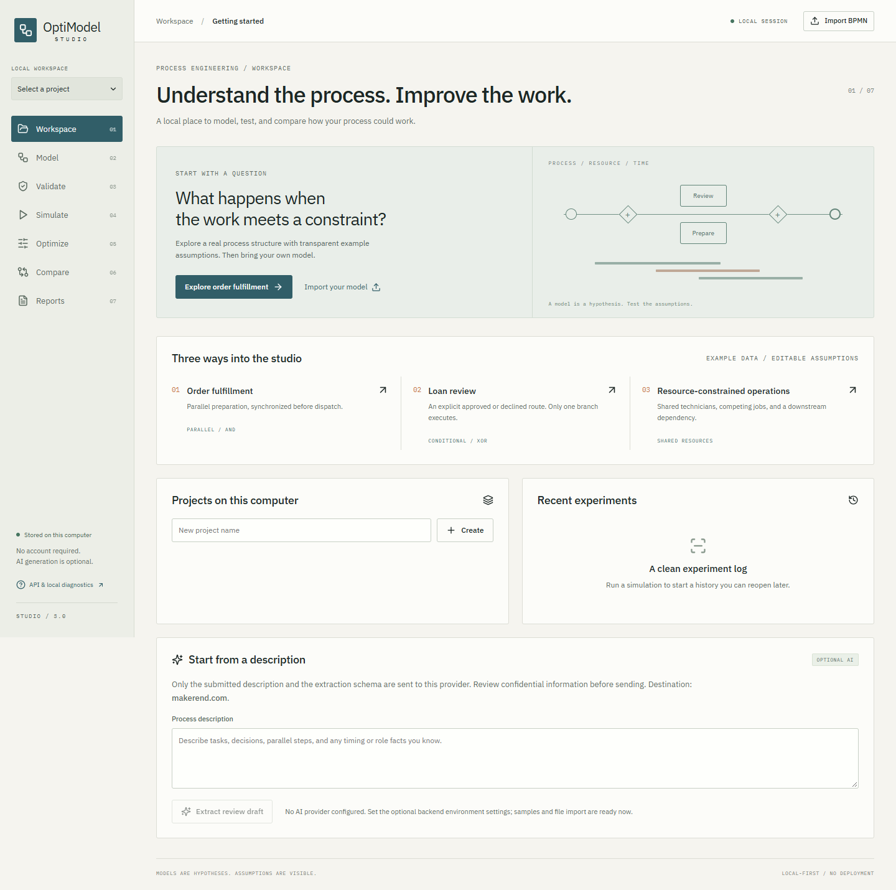

# OptiModel Studio

A local process engineering workspace: import BPMN, review the model, validate supported token semantics, simulate explicit resource assumptions, and compare fair scheduling experiments. Projects, source versions, scenarios, results and exports survive restarts. No account or AI key is needed for the core journey. Nothing is deployed.



## Start locally

Install **Python 3.12+** and **Node.js 22.12+ with npm**. First setup needs internet access to install dependencies; normal operation runs offline. Graphviz is not required.

From the repository root on Windows PowerShell or Command Prompt:

```powershell
python run.py --setup
```

On Linux/macOS:

```bash
python3 run.py --setup
```

Open **http://127.0.0.1:8000**. Keep that terminal open; Ctrl+C stops the server. Later starts use `python run.py` (Windows) or `python3 run.py` (Linux/macOS). `run_all.ps1`, `run_all.bat` and `sh run_all.sh` wrap first setup. Setup creates `backend/.venv`, installs the pinned runtime closure, runs `npm ci`, builds the bundled frontend and starts one loopback FastAPI server.

If port 8000 is occupied, use `python run.py --port 8001`; do not terminate an unrelated service. `python run.py --check` checks local readiness without starting a server. Windows commands were executed in this environment; Linux/macOS scripts have not been executed here.

## First experiment (no key)

1. In **Workspace**, choose **Resource-constrained operations**. It creates a local project if needed and saves an immutable model version.
2. Inspect the BPMN and select a task, then click **Validate model**. The supported model reports no bounded counterexample; this is not a claim of complete BPMN soundness.
3. In **Simulate**, review the example durations, two Technician slots and hourly cost assumptions. Run the baseline: **13 hours**.
4. Open **Optimize** and run the fixed-resource solver. The observed optimum is **11 hours**, with the same two technicians and unchanged task durations. This is a **15.3846% simulated scheduling change**, not a measured business saving.
5. In **Compare**, select the baseline and optimization run. Change capacity only in a new scenario and it will be labeled separately.
6. In **Reports**, download that run's original BPMN, schedule CSV, results JSON, PDF or ZIP. Refresh/restart and reopen the project to find its history.

Other samples: **Order fulfillment** (parallel preparation and synchronization) and **Loan review** (approved/declined exclusive routing). All sample timings/staffing/rates are illustrative assumptions. Existing `frontend/1.xml`, `frontend/2.xml` and `diagram_1.bpmn` remain intact; the last file has no explicit duration metadata and requires scenario inputs.

## Supported scope

| Capability | Current behavior |
|---|---|
| BPMN core | One acyclic process, one plain start/end, normal/user/service tasks, explicit AND split/join and XOR split/merge |
| Timing and resources | One deterministic case, positive stated durations, continuously available role-specific slots |
| XOR routing | Explicit selected flow or API-supplied seeded probabilities; conditions are labels, never executed code |
| Optimization | CP-SAT minimizes completion with identical roles, capacities and durations; validated candidates, real statuses/bounds/gaps, honest baseline fallback |
| Unsupported | Loops, advanced events/gateways, subprocesses, collaboration, calendars, multi-instance/multi-case semantics; XOR optimization |
| Verification | Bounded marking exploration, traces, exact completion and reverse reachability; truncation is inconclusive; no full soundness claim |
| Editing | Source XML edits become new validated versions; separate display layout if coordinates are missing |

See the [support matrix](docs/bpmn-support-matrix.md) and [metrics/assumptions](docs/metrics-and-assumptions.md). A scheduling experiment exports the **Original / Analyzed BPMN** unchanged. Revised process transformations, automated capacity Pareto search, stochastic durations and multi-case throughput are not implemented.

## Optional AI configuration

Copy `backend/.env.example` to `backend/.env`, then set a provider endpoint, a model actually offered by that provider, and its key:

```dotenv
AI_BASE_URL=https://makerend.com/v1
AI_MODEL=
AI_API_KEY=
```

Supply your own values for the blank fields; no named model is assumed to exist. Existing `MAKEREND_API_KEY`, `MAKEREND_MODEL` and `MAKEREND_BASE_URL` are supported as fallbacks. Local OpenAI-compatible servers can use an HTTP loopback base URL without a key; remote endpoints require HTTPS. Restart after changing environment settings.

The UI shows the provider destination before sending a description. Only the submitted description and extraction schema are sent. The provider returns structured JSON, which remains a draft until the analyst reviews task/branch fidelity and resolves material ambiguity. XML and display coordinates are generated deterministically after review. No secret goes to browser code; no fabricated fallback is used on failure. Do not put a key in `.env.example` or commit `.env`.

## Data, API and migration

Data defaults to `data/studio.sqlite3` and `data/artifacts/<project>/<run>/`. Set `OPTIMODEL_DATA_DIR` to another local path if needed. Back up that entire directory while the server is stopped. Use one server per data directory. Removing runs/projects hides their downloads but retains local files intentionally.

The versioned API lives at `/api/v1`; offline route documentation is at **http://127.0.0.1:8000/docs**, with a complete `/openapi.json` contract. APIs cover project CRUD, model import/versioning, multipart upload, validation, saved scenarios, simulation/optimization jobs, status/cancel/history, comparison, generation review and run-specific artifacts. Legacy `/analyze` and global report routes return **410 Gone**; clients must migrate to project/model/run IDs. Original legacy generated files are not used by Studio.

## Development and validation

Install development Python dependencies:

```powershell
backend\.venv\Scripts\python -m pip install -r backend/requirements-dev.txt
backend\.venv\Scripts\python -m pytest backend/tests -q
backend\.venv\Scripts\python -m ruff check backend/app backend/tests run.py scripts
backend\.venv\Scripts\python -m ruff format --check backend/app backend/tests run.py scripts
```

On Linux/macOS, replace `backend\.venv\Scripts\python` with `backend/.venv/bin/python`.

```bash
cd frontend
npm ci
npm run lint
npm run typecheck
npm run format:check
npm run build
npm run test:e2e
```

Browser tests use installed Chrome by default and an isolated temporary store on port **8017**. They do not touch your projects. For bundled Chromium, run `npx playwright install chromium` and set `PLAYWRIGHT_CHANNEL=chromium`. No test server should already occupy port 8017. Run `npm run dev` for Vite on 5173 while the loopback backend runs on 8000; API calls proxy through Vite. `python run.py --dev` reloads the backend.

Measured checks and exact results are in [validation and benchmarks](docs/validation-and-benchmarks.md). Report rendering QA additionally uses the optional `backend/requirements-qa.txt`; `backend/.venv/Scripts/python scripts/benchmark.py` writes sample evidence under `docs/evidence` and isolated intermediate artifacts under `tmp/qa-data`.

## Troubleshooting

- **Missing Python or npm:** install the prerequisites, reopen the terminal, rerun `--setup`. Follow the reported installation error; startup does not silently ignore it.
- **Missing module / UI build:** rerun `python run.py --setup`; the frontend must be built before normal startup.
- **PowerShell execution policy:** use `python run.py --setup` directly instead of changing machine policy.
- **Rejected model:** inspect linked element IDs and the support matrix. A valid BPMN file may use unsupported semantics. Do not remove diagnostics just to obtain a number.
- **Unknown timings/roles:** enter them explicitly in Simulate and choose a consistent unit. Names containing durations are not parsed as measured facts.
- **No improvement:** a baseline can already be optimal. Read the solver status and bound; staffing changes need a separate run.
- **AI unavailable:** file import, samples, validation, simulation, optimization and exports remain available. Check model/key/endpoint or use a local provider. Live provider behavior has not been tested with real credentials here.
- **Missing old artifacts:** original source reports were untracked and retained locally. Studio results are stored only under their run IDs; global "latest" downloads are retired.

[Architecture](docs/architecture.md) · [Engineering audit](docs/engineering-audit.md) · [Progress and remaining limits](docs/implementation-progress.md) · [Exact changed files](docs/change-manifest.md)
